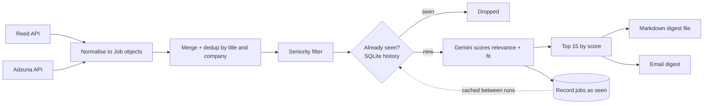

# UK Job Search Agent

A small agent that checks UK job boards every morning, filters out roles that don't fit, asks an LLM which ones are genuinely relevant to my background, remembers what it has already shown me, and emails me the top 15 new roles. It runs on GitHub Actions, so it works while my laptop is off.

I built it to find graduate AI/ML and data science roles, and to learn how to put an LLM step, persistent state and scheduled automation together in one small system.

## How it works



1. **Collect.** For each search term (machine learning engineer, AI engineer, data scientist, MLOps engineer) the agent queries the Reed and Adzuna APIs.
2. **Normalise.** Both sources are converted into one `Job` dataclass (title, company, location, url, source, salary, description).
3. **Dedup and filter.** Duplicates are removed using a `title|company` key, and titles containing senior-level words (senior, lead, principal, II, III and so on) are dropped.
4. **Remember.** A SQLite table of previously seen jobs removes anything already shown on an earlier day.
5. **Rank.** Only the new jobs go to Gemini in one batched call. The response is validated with a Pydantic schema: a `relevant` flag, a 0-100 `score` and a one-sentence `reason` per job.
6. **Deliver.** The top 15 are written to `digests/job_digest_YYYY-MM-DD.md` and emailed.

## Project layout

| File | Purpose |
|---|---|
| `main.py` | Orchestrates the pipeline, writes the digest, sends the email |
| `reed_client.py`, `adzuna_client.py` | API clients and normalisers |
| `models.py` | Shared `Job` dataclass and dedup key |
| `aggregate.py` | Merge, dedup and seniority filter |
| `ranker.py` | Gemini scoring with structured output, retries and model fallback |
| `storage.py` | SQLite history of seen jobs |
| `emailer.py` | Gmail SMTP sender |
| `list_models.py` | Lists the Gemini models my API key can call |
| `.github/workflows/daily-digest.yml` | Daily schedule, history cache, artifact upload |

## Setup

```bash
git clone https://github.com/Jagadesh-18/uk-job-search-agent.git
cd uk-job-search-agent
python -m venv venv
venv\Scripts\activate          # Windows PowerShell; use `source venv/bin/activate` on macOS/Linux
pip install -r requirements.txt
cp .env.example .env           # then fill in the keys
python main.py
```

`.env` keys: `REED_API_KEY`, `ADZUNA_APP_ID`, `ADZUNA_APP_KEY`, `GEMINI_API_KEY`, `EMAIL_ADDRESS`, `EMAIL_APP_PASSWORD` (a Gmail app password, not the account password).

### Running it in the cloud

Add the same six values as repository secrets (Settings > Secrets and variables > Actions). The workflow runs daily and can also be started manually from the Actions tab.

## Design decisions and lessons learned

- **Model fallback.** The Gemini API failed in three different ways during development: a retired model, a model closed to new accounts, and temporary 503 overloads. `ranker.py` retries with exponential backoff and then falls back through a list of models. `list_models.py` shows which models a key can actually call.
- **Constraints belong in the schema.** An early version scored 0-10 on one model and 0-100 on another, because the range was only a Python comment. Putting the description and `ge`/`le` limits into the Pydantic schema fixed it.
- **A stateless runner needs explicit memory.** GitHub Actions starts from a clean machine every run, so the SQLite file is saved and restored with `actions/cache`.
- **Rank the right list.** A bug had the agent check for unseen jobs but then score and rank the full list, so old jobs kept coming back even though the memory was working. The fix was scoring only the unseen jobs, which also reduced LLM calls from about 100 per run to a handful.
- **Keyword search is noisy.** "Machine learning" also returns unrelated roles, which is why an LLM relevance step exists at all.

## Limitations

- **No learning yet.** The agent does not adapt to my feedback. Ranking quality depends on one prompt and a short CV summary.
- **LLM scores are noisy.** Scores can tie, and the reasons can be generic. I have not yet measured how well they match my own judgement.
- **Dedup is simple.** It uses title and company, so a reposted role with a slightly different title can reappear, and two genuinely different roles at one company with the same title are treated as one.
- **Salary data is unreliable.** Adzuna salaries are often estimates, and Reed sometimes returns day rates.
- **History expires.** GitHub deletes caches that are unused for 7 days, so if the schedule is paused for a week the agent starts with no memory.
- **Two sources only.** Reed and Adzuna cover a lot of the UK market but not company career pages.
- **Scheduled runs are not exact.** GitHub's cron can start late.

## Roadmap

- Feedback loop: mark roles as interesting or not, and use those labels to adjust ranking.
- Evaluate the LLM scores against my own labels.
- Add company career-page feeds (Greenhouse and Lever).
- Only mark jobs as seen after the email has been sent successfully.

## Data and ethics

The agent uses the official Reed and Adzuna APIs under my own keys and does not scrape websites. It reads job adverts only, and the digest is sent to my own inbox. It doesn't store personal data about anyone else. The CV summary used for ranking is mine.
